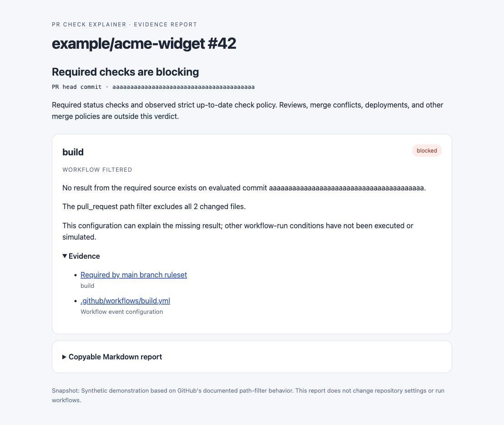

# GitHub PR Check Explainer: troubleshoot missing required checks

[](https://github.com/builtbysharath/gh-pr-check-explainer/actions/workflows/ci.yml)

**A pull request shows “Expected” and keeps waiting for a required status check. Which result is missing, and what can explain it?**

PR Check Explainer is a read-only CLI for developers troubleshooting GitHub required status checks. It names the missing requirement, checks the commit and reporting App, and connects supported workflow filters or job renames to the missing result. Incomplete evidence stays explicitly uncertain.



*Fictional example, not a diagnosis of a live repository. A workflow filter can explain a missing result; this tool does not run or simulate Actions.*

**[Explore the example report](https://builtbysharath.github.io/gh-pr-check-explainer/)**. No installation needed to view the fictional demonstration. Live PR analysis runs through the CLI on your own computer.

## Try it on a pull request

Requires **Node 22+** and [GitHub CLI](https://cli.github.com/) signed in with access to the repository. Install it as a GitHub CLI extension, then paste a PR link:

```sh
gh extension install builtbysharath/gh-pr-check-explainer
gh pr-check-explainer https://github.com/OWNER/REPO/pull/NUMBER
```

The extension runs a committed single-file build of this source (`dist/`, rebuilt and compared in CI), so there is no npm install step. It follows `main`; add `--pin v0.3.0` to stay on a release. Update with `gh extension upgrade pr-check-explainer` or remove with `gh extension remove pr-check-explainer`. The tool uses your existing `gh` access to read GitHub data. It does not rerun workflows, post comments or change repository settings.

Prefer not to install anything? Run the pinned release once through npm:

```sh
npm exec --yes --package=https://github.com/builtbysharath/gh-pr-check-explainer/releases/download/v0.3.0/gh-pr-check-explainer-0.3.0.tgz -- gh-pr-check-explainer https://github.com/OWNER/REPO/pull/NUMBER
```

npm downloads the GitHub release package and its dependencies. The package is not published to the npm registry.

Prefer a checkout, or want the fictional sample?

```sh
git clone https://github.com/builtbysharath/gh-pr-check-explainer.git
cd gh-pr-check-explainer
npm ci
node bin/gh-pr-check-explainer.js --snapshot examples/path-filter.json
```

The sample intentionally exits `1` because a required check is blocked.

## Run it on every pull request (GitHub Action)

Add this workflow as `.github/workflows/explain-required-checks.yml`. Give it no `paths` or `branches` filter, so it runs on every pull request:

```yaml
name: Explain required checks
on:
  pull_request:
# One run per pull request at a time, so two quick pushes can't post two comments.
concurrency:
  group: explain-required-checks-${{ github.event.pull_request.number }}
  cancel-in-progress: true
permissions:
  contents: read
  actions: read
  checks: read
  statuses: read
  pull-requests: write
jobs:
  explain:
    runs-on: ubuntu-latest
    steps:
      - uses: builtbysharath/gh-pr-check-explainer@v0
```

When a required check can't report because of configuration, the action posts one comment on the pull request with the check, the cause and a fix, and updates that comment on later pushes. Causes it recognizes: a `paths` or `branches` filter that skips the workflow, a workflow with no pull request event, a job the pull request renames or removes, a check from a different GitHub App than the rule requires, and a result from an event that can't satisfy a pull request requirement. Checks that are queued or still running aren't reported. Every run writes the full report to the job summary.

| Input | Default | Use |
|---|---|---|
| `github-token` | `${{ github.token }}` | Token for the read-only requests and the comment |
| `comment` | `true` | `false` keeps the report in the job summary only |
| `fail-on-stuck` | `false` | `true` fails the job when a required check won't report |

Outputs: `verdict` (`blocked`, `unknown`, `satisfied` or `none`) and `stuck-checks` (a JSON array of check names).

Apart from that one comment, the action only reads. The workflow token has no admin access, so classic branch protection is read from the branch summary, which doesn't say whether branches must be up to date. On `pull_request`, pull requests from forks get a read-only token: the action then skips the comment with a warning, and the job summary still has the report.

## Audit a branch before a pull request gets stuck

`--audit` compares a branch's required checks with the workflows on that branch. No pull request is needed:

```sh
gh pr-check-explainer --audit OWNER/REPO
gh pr-check-explainer --audit OWNER/REPO --branch release/1.x --format json
```

It flags required checks that some pull requests would wait for:

- The workflow that reports the check has a `paths`, `branches` or `types` filter on `pull_request`.
- The workflow runs only on `push`, so pull requests from forks never get the check, or only on events that can't satisfy a pull request requirement.
- No workflow has a job with that name, and the rule requires GitHub Actions.
- Several workflows report the same name.
- The branch uses a merge queue, and the workflow has no `merge_group` trigger or `push` trigger that runs on the queue's `gh-readonly-queue/` branches.

Exit code `1` means at least one risk was found. Checks from other GitHub Apps are listed as not checked. Checks whose job names come from dynamic matrices or reusable workflows stay unknown.

## What you get

- **Named missing checks**, including requirements that have no result to list.
- **Commit and App evidence**, so an older success or a different reporting App is not silently treated as satisfying the requirement.
- **Workflow explanations** for supported filters and static job renames, plus observed strict branch-freshness requirements.
- **Portable text, JSON, Markdown or HTML reports** with evidence links and coverage notes.

```sh
node bin/gh-pr-check-explainer.js --repo OWNER/REPO --pr NUMBER --format html --output report.html --save-snapshot evidence.json
```

You can also pass a standard PR URL:

```sh
node bin/gh-pr-check-explainer.js https://github.com/OWNER/REPO/pull/NUMBER --format html --output report.html
```

Use either the URL or `--repo`/`--pr`; a URL cannot be combined with those options or `--snapshot`.

Snapshots and reports can contain private workflow contents. Review them before sharing. HTML reports include a fixed local copy helper permitted by a CSP hash and no remote assets. Copy Markdown provides success or failure feedback; manual text selection remains available if clipboard access is unavailable.

## Where it helps and where it stops

The verdict covers **required status checks**, not every condition for merging. Live mode supports open PRs on GitHub.com. Matrix job names are expanded as GitHub names them. Matrices built from expressions, reusable workflows and some complex filter patterns are outside this release's coverage. Missing permissions or ambiguous evidence produce an unknown verdict.

[Full coverage and limits](docs/COVERAGE.md) · [Captured comparison with GitHub CLI and gh-x](BENCHMARK.md) · [Validation evidence](VALIDATION.md)

The captured comparison shows one draft PR where this tool names an absent requirement omitted from the other captured summaries. Its root cause remains unconfirmed. More independent diagnoses and developer feedback are needed.

[Why is a required check waiting for a status?](docs/expected-status-check.md)

## Feedback and development

Did it clarify a stuck PR? [Open an issue](https://github.com/builtbysharath/gh-pr-check-explainer/issues/new) with a public PR link, the tool version and whether the explanation matched what you found. Sanitize private snapshots and never include tokens.

```sh
npm test
npm run check
```

Reusable analysis: `import {analyze} from './src/analyze.js'`. Exit codes: `0` observed checks satisfied/no required checks; `1` blocker; `2` incomplete evidence or error. See `--help` for options.

MIT licensed · [Releases](https://github.com/builtbysharath/gh-pr-check-explainer/releases) · [Contributing](CONTRIBUTING.md) · [Security](SECURITY.md) · [Dependency notices](THIRD_PARTY_NOTICES.md)
